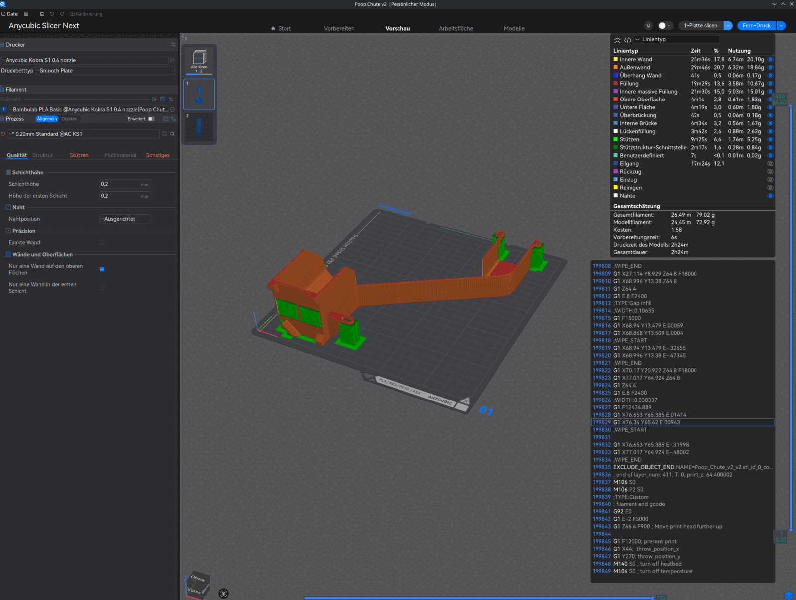
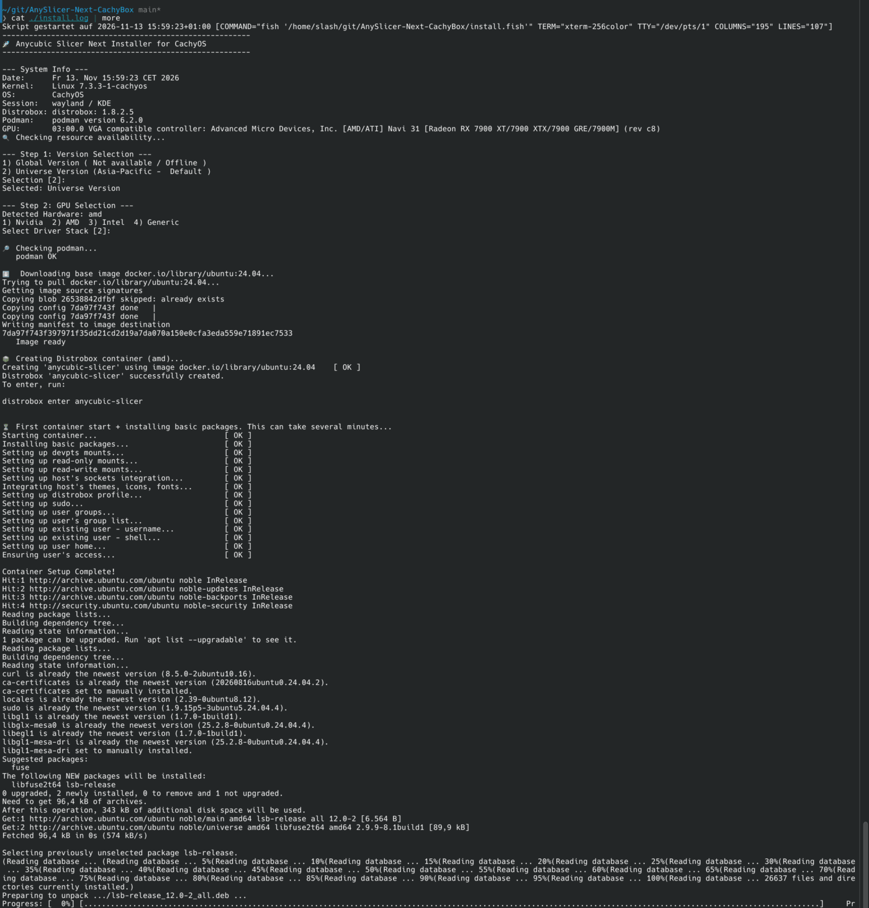

# AnySlicer-Next-CachyBox 🚀
### Anycubic Slicer Next: CachyOS Container Edition

This project provides a reliable and high-performance way to run the **Anycubic Slicer Next** on Linux distributions (specifically optimized for **CachyOS**) using **Distrobox** and **Podman**. By isolating the slicer in an Ubuntu 24.04 LTS container, we avoid library conflicts and ensure a stable environment while maintaining native hardware acceleration.

---

## ✨ Features

*   **Smart Region Selection:** Automatically checks if the **Global** (International) installer is online. If unreachable, it defaults to the **Universe** version with a status warning.
*   **Hardware-Aware Detection:** Automatically identifies Nvidia, AMD, or Intel GPUs and sets up the correct driver stack.
*   **Manual Hardware Override:** Allows users to manually force a specific driver stack (Nvidia, AMD, Intel, or Generic) during setup.
*   **Image Source Selection:** Choose between pulling a standard image from DockerHub or building a locally optimized image via specific `Containerfiles`.
*   **Automatic Resource Management (Auto-Stop):** The container automatically shuts down (`distrobox stop`) as soon as the Slicer window is closed, freeing up system RAM and CPU.
*   **Desktop Integration:** Clean integration into your application menu with corrected icon paths and categories.
*   **Robust Network Handling:** Automatically detects DNS resolution issues (common on Arch/CachyOS) and retries the installation with a custom DNS fix (1.1.1.1) if the first attempt fails.

---

## 📸 Screenshots

**Anycubic Slicer Next running in the container** (CachyOS, KDE Plasma / Wayland, AMD Radeon RX 7900 XTX) with a sliced example model:

<p align="center">
  <a href="docs/slicer-sliced-model.png">
    
  </a>
</p>

<details>
<summary><b>Example installation</b> (contents of <code>install.log</code>, click to expand)</summary>
<br>
<p align="center">
  <a href="docs/install-log-example.png">
    
  </a>
</p>
</details>

---

## 🛠 Prerequisites

The installer needs the following on your host system:
*   **Podman** (Container Engine)
*   **Distrobox** (Container Integration Tool)
*   **curl** (for resource checking)
*   **Nvidia-utils** (Only if you are using an Nvidia GPU — `nvidia-smi` must work on the host)

If Podman, Distrobox or curl are missing, the installer installs them automatically (pacman on CachyOS/Arch; `install.sh` also supports apt and dnf).

---

## 🚀 Installation

1.  **Clone the Repository:**
    ```bash
    git clone https://github.com/Slashdacoda/AnySlicer-Next-CachyBox.git
    cd AnySlicer-Next-CachyBox
    ```

2.  **Run the Installer:**
    *   **For CachyOS Users (Fish Shell):**
        ```fish
        chmod +x install.fish
        ./install.fish
        ```
    *   **For Universal Linux Users (Bash Shell):**
        ```bash
        chmod +x install.sh
        ./install.sh
        ```

    > ⚠️ **Do not use `sudo`.** Run the installer as your normal user. Distrobox must run rootless; with `sudo` it refuses to run ("Running distrobox-enter via SUDO/DOAS is not supported") or creates a root-owned container. The script asks for your password itself when it needs to install host packages.

3.  **Follow the Prompts:** The script will guide you through Region, GPU Driver, and Image Source selection.

4.  **Be patient on first start:** Creating the container and installing the packages can take several minutes. With **Nvidia**, the first container start links the host driver into the container and may show no output for a while — this is not a freeze.

---

## 📂 File Structure

| File | Purpose |
| :--- | :--- |
| `install.fish` | Optimized interactive installer for **CachyOS** and Fish shell users. |
| `install.sh` | Universal **Bash** installer for other Linux distributions. |
| `uninstall.fish / .sh` | Complete cleanup of containers, local images, and menu entries. |
| `containerfile.[gpu]` | Blueprints for building locally optimized images (AMD, Nvidia, Intel). |
| `install.log` | Created by the installer: full output of the last run (ignored by git). |
| `uninstall.log` | Created by the uninstaller: full output of the last run (ignored by git). |
| `docker-compose.yml` | Configuration to run the Slicer as a standalone pod via `podman-compose`. |
| `docs/` | Screenshots used in this README. |

---

## ⚙️ Functionality Summary

1.  **Hardware-Override:** The script detects your GPU (e.g., AMD 7900XTX) but allows you to force a driver choice (1-4). This is useful if detection fails or if you want to test different rendering stacks.
2.  **Image-Source:** You can choose the **Standard Hub** image for a fast setup or **Local Build** to create an image tailored specifically to your GPU drivers.
3.  **Auto-Stop:** After exporting the app, the scripts modify the `.desktop` launcher. It wraps the execution command so that closing the Slicer window automatically triggers a `distrobox stop` command to clean up background processes.
4.  **Menu Cleanup:** Fixed the common "broken icon" problem by automatically stripping the `/run/host` prefix from exported desktop files for perfect rendering in KDE/Gnome.

---

## 🐳 Advanced Usage: Podman-Compose

You can run the Slicer using `podman-compose` independently of the Distrobox desktop integration.

### How to use:

**1. Set the Image Variable:**
*   **Fish Shell:** `set -x ANYCUBIC_IMAGE anycubic-custom-amd` (or `nvidia`/`intel`)
*   **Bash Shell:** `export ANYCUBIC_IMAGE=anycubic-custom-amd`

**2. Launch:**
```bash
podman-compose up
```

---

## 🔍 Troubleshooting

*   **DNS Issues:** If the installer fails with "Could not resolve host", the script will automatically retry with `--dns 1.1.1.1`.
*   **"Running distrobox-… via SUDO/DOAS is not supported":** You started the installer with `sudo`. Run it again as your normal user (`./install.fish` or `./install.sh`).
*   **Installer hangs at "Creating Distrobox container" (Nvidia / Generic):** Fixed. Older versions of this installer passed an empty `--additional-flags` value to `distrobox create`, which makes distrobox loop forever at 100% CPU without any output. Update to the latest version (`git pull`).
*   **First start with Nvidia is slow:** The first container start with `--nvidia` can take several minutes without output. Wait, and check that `nvidia-smi` works on the host. If it does not, fix the host driver (e.g. `nvidia-utils`, then reboot) or choose `4) Generic`.
*   **Debug mode:** Run `ANYSLICER_DEBUG=1 ./install.fish` (or `ANYSLICER_DEBUG=1 ./install.sh`) to run distrobox with `--verbose`. The detailed output ends up in `install.log` and shows exactly where something hangs. Please attach that log when opening an issue.
*   **Install Log:** Every installer run writes its complete output (including your selections and a short system-info block with kernel, distro, session type, distrobox/podman versions and GPU/driver) to `install.log` in the repository folder. The file is overwritten on each run. Please attach it when reporting a problem. The uninstaller does the same and writes `uninstall.log`.
*   **GUI / Graphics:** If the window does not appear, Nvidia users should ensure the `nvidia-container-toolkit` is installed on the host.
*   **libfuse Error:** The script installs `libfuse2*` inside the container. If you encounter FUSE errors, ensure your host user has permissions to mount FUSE devices.
*   **Broken Icons:** If the icon is missing after installation, run `update-desktop-database ~/.local/share/applications`.

---

## ❓ FAQ

### Why Distrobox?
Anycubic Slicer Next requires specific library versions (like `glibc`). On rolling-release distros like **CachyOS**, these libraries are often too new, causing the Slicer to crash. Distrobox provides a stable Ubuntu environment while allowing the app to appear native on your desktop.

### Does this affect performance?
No. There is zero overhead for 3D rendering. Your GPU is passed through directly to the container using Mesa/DRI or Nvidia drivers, providing native FPS for the 3D preview.

### Where are my settings stored?
Your custom printer and filament profiles are stored on your host at `~/.config/AnycubicSlicerNext/`. They persist even if you delete or recreate the container.

---

## 🗑 Uninstallation

To completely remove the Slicer, the container, and all local images:
`./uninstall.fish` or `./uninstall.sh`

## 🤝 Credits
This project was co-developed with the help of an AI assistant to provide a seamless and robust experience for the CachyOS community.
